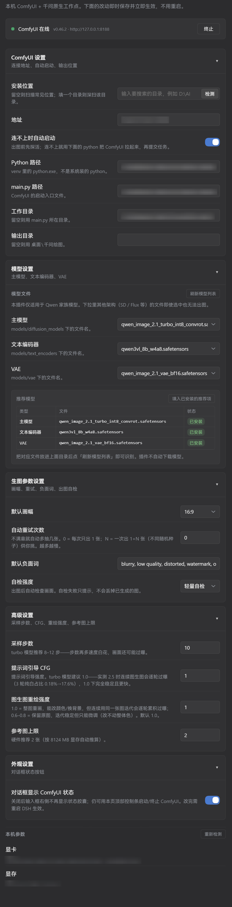

# Qwen Draw

> 在 [DeepSeek Harness](https://github.com/deepseek-ai) 里用本机 ComfyUI 生成图片的插件

给一段描述，出一张图。给几张参考图，按描述改。全程在本机跑，不联网、不花钱。

[](./LICENSE)
[]()
[]()

---

## 特性

| 能力 | 说明 |
|---|---|
| **文生图** | 一句话出图，支持 7 种画幅 |
| **图生图** | 1–3 张参考图，换背景、改颜色、保持人物形象续画 |
| **实时进度** | 输入框右侧胶囊显示「准备中 3s」「出图中 4/10」，带填充式进度条 |
| **自动启停 ComfyUI** | 出图前探活，没启动就自动拉起 |
| **出图自检** | 可选：检查尺寸文件 / 调用视觉模型看画面 |
| **自动重试** | 可选：一次出多张不同种子供挑选 |
| **原生设置页** | 5 个折叠面板，集成在 DSH 设置里，改完即时生效 |
| **路径自动检测** | 首次安装扫一遍磁盘，自动填好 Python 和 main.py 路径 |

## 截图

<details open>
<summary><b>设置页全貌</b>（五个折叠面板：ComfyUI / 模型 / 参数 / 高级 / 外观）</summary>



</details>


## 环境要求

- **ComfyUI**：已安装并可运行（默认 `http://127.0.0.1:8188`）
- **显卡**：建议 8 GB 显存以上
- **模型**：Qwen 家族（见下方[推荐模型](#推荐模型)）

> ⚠️ **只支持 Qwen 家族模型**。SD、SDXL、Flux 等架构的工作流不同，选中也无法出图。

## 安装

### 1. 克隆到工作区

```bash
cd <你的 DSH 工作区>
git clone https://github.com/Hits-pano/dsh-qwen-draw.git
```

### 2. 链接到 DSH profile

Windows（Junction）：

```powershell
New-Item -ItemType Junction `
  -Path "$env:USERPROFILE\.dsh\profiles\<profile>\node_modules\@local\qwen-draw" `
  -Target "<你的 DSH 工作区>\dsh-qwen-draw"
```

macOS / Linux（软链接）：

```bash
ln -s <你的 DSH 工作区>/dsh-qwen-draw \
  ~/.dsh/profiles/<profile>/node_modules/@local/qwen-draw
```

### 3. 在 profile 里启用

编辑 `~/.dsh/profiles/<profile>/cordis.patch.yml`，加入：

```yaml
- insert:
    - id: qwen-draw
      name: '@local/qwen-draw'
```

### 4. 重启 DSH

打开 DSH 设置，看到「Qwen Draw」区块即安装成功。

## 首次配置

### 检测路径

设置页 →「ComfyUI 设置」→「安装位置」：

```
安装位置
留空则扫描常见位置；填一个目录则深扫该目录。
                    [输入要搜索的目录…    | 检测 ]
```

- **留空点「检测」**：扫常见安装位置（12 秒内出结果）
- **填目录点「检测」**：深扫那个目录（最多 5 层、30 秒）

找到后自动填入 Python、main.py、工作目录三个路径。

### 推荐模型

| 类型 | 文件 | 目录 |
|---|---|---|
| 主模型 | `qwen_image_2.1_turbo_int8_convrot.safetensors` | `models/diffusion_models` |
| 文本编码器 | `qwen3vl_8b_w4a8.safetensors` | `models/text_encoders` |
| VAE | `qwen_image_2.1_vae_bf16.safetensors` | `models/vae` |

放进对应目录 → 点「刷新模型列表」→ 表格状态变「已安装」→ 点「填入已安装的推荐项」。

> 插件**不会**替你下载模型，只负责告诉你缺什么、装没装。
>
> 想用非 turbo 版本（画质更好、慢一倍多）也可以，那三个文件换掉即可，其余设置不变（步数改 25）。

## 使用

### 文生图

```
画一只坐在窗台上的橘猫，午后阳光，写实风格
```

### 图生图

把参考图一起发过来，再说要改什么：

```
[图片1] 把这张图的背景换成海边
[图片1, 图片2] 用这两个人的形象，画他们一起走在街上
```

参考图最多 3 张（实际生效张数按显存自动限制）。

### 连续镜头

以上一张图为参考再生成，人物形象、场景、光线能保持一致——适合做分镜。

## 设置项

<details>
<summary><b>ComfyUI 设置</b></summary>

| 项 | 说明 |
|---|---|
| 安装位置 | 自动检测路径 |
| 地址 | ComfyUI 的 HTTP 地址，默认 `http://127.0.0.1:8188` |
| 自动启动 | 出图前发现没运行就自动拉起 |
| Python / main.py / 工作目录 | 自动启动时用 |
| 输出目录 | 留空 = `桌面\千问绘图` |

</details>

<details>
<summary><b>模型设置</b></summary>

UNET / CLIP / VAE 三个下拉，列出 ComfyUI 实际认得的文件。

带 `⚠ 不兼容` 标记的是非 Qwen 架构，选中也跑不通。

底部「推荐模型」表格显示本机装了哪些推荐文件。

</details>

<details>
<summary><b>生图参数设置</b></summary>

| 项 | 说明 |
|---|---|
| 默认画幅 | 1:1 / 4:3 / 3:4 / 16:9 / 9:16 / 3:2 / 2:3 |
| 自动重试 | 0 = 只出一张；N = 一次出 1+N 张不同种子 |
| 默认负面词 | 反向提示词 |
| 出图自检 | 不自检 / 轻量（尺寸+文件大小）/ 视觉（用视觉模型看画面） |

</details>

<details>
<summary><b>高级设置</b></summary>

| 项 | 说明 |
|---|---|
| 采样步数 | turbo 模型 10 步；非 turbo 25 步 |
| CFG | **turbo 模型建议 1.0**。实测 2.5 时连续图生图会逐轮过曝 |
| 图生图重绘强度 | 1.0 = 整图重画（改动大）；0.6–0.8 = 保留原图（改动小） |
| 参考图上限 | 实际生效 = min(你填的值, 按显存推算值)。填高了输入框变红 |

</details>

<details>
<summary><b>外观设置</b></summary>

| 项 | 说明 |
|---|---|
| 对话框显示 ComfyUI 状态 | 关掉后输入框右侧的状态胶囊消失（需重启 DSH 生效） |

</details>

## 常见问题

**出图很慢 / 卡在「准备中」很久**

准备阶段是 ComfyUI 在加载模型、编码提示词。冷启动 7–15 秒正常，**超过 60 秒基本可判定卡住**，点状态胶囊终止重来。

**模型下拉是空的**

ComfyUI 没运行，也没有缓存。先在设置页顶部点「启动」，或直接出一次图。

**报错说找不到模型**

检查文件是否放进正确目录、文件名是否和下拉一致，然后点「刷新模型列表」。

**连续生图越来越白 / 过曝**

检查「高级设置 → CFG」是否过高。turbo 模型建议 1.0。

**参考图超过 2 张就卡死**

显存不足。8 GB 显卡建议最多 2 张，插件会按显存自动限制。

## 已知限制

- **出图质量由模型决定**，不是插件的能力。插件只负责把调用链路打通、把参数配置好；画得好不好取决于你用的 Qwen 模型版本与采样设置。
- **只支持 Qwen 家族模型**，SD / Flux 等架构无法运行
- **工作流内置**，不支持导入自定义 ComfyUI 工作流（需要 LoRA、ControlNet 请改源码）
- **不支持视频生成**
- **模型需自行下载**，插件不提供下载功能

## 致谢

本插件的设计参考了 **[dsh-qwen-paint](https://github.com/yanfei0725/dsh-qwen-paint)**（作者 [@yanfei0725](https://github.com/yanfei0725)）。

该项目的许可情况：

| | |
|---|---|
| 当前许可 | **BUSL-1.1**（Business Source License 1.1，非 OSI 开源许可） |
| 适用范围 | 0.33.0 及以后版本 |
| 0.32.1 及更早 | MIT（永久、不可撤销、不追溯） |
| Change Date | 2030-11-15 起转为 Apache-2.0 |

参考的部分：

- 文生图 / 图生图的 ComfyUI 节点图结构
- Qwen-Image turbo 模型的推荐步数与 CFG 取值
- 图生图基于参考图 latent 的实现思路
- 出图链路的整体调试经验

**本插件为独立实现**：全部代码重写，未包含 dsh-qwen-paint 的源代码。

在它基础上做的改动：

- 把设置页集成进 DSH 设置中心，而不是独立页面
- 重写状态轮询与启停逻辑，抽出共享 hook
- 增加路径自动检测、推荐模型引导、进度填充条
- 修正了 CFG 过高导致的连续生图过曝问题

感谢原作者的探索。

## 许可

[MIT](./LICENSE) © 2026

模型与 ComfyUI 各自遵循其原始许可。
