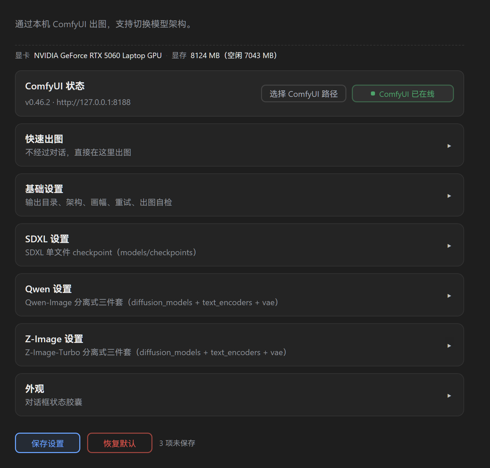
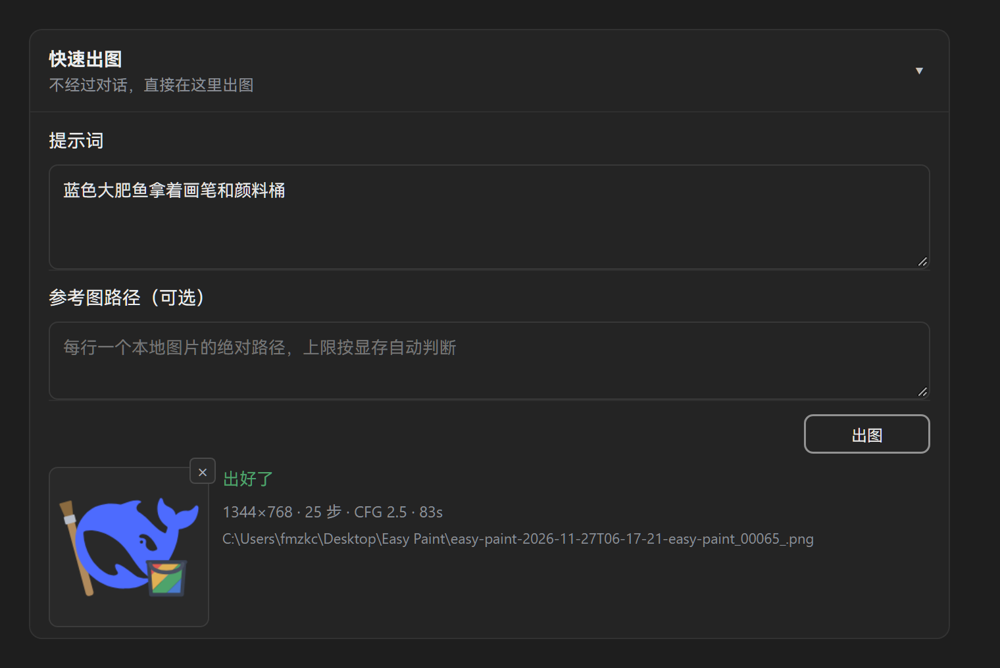
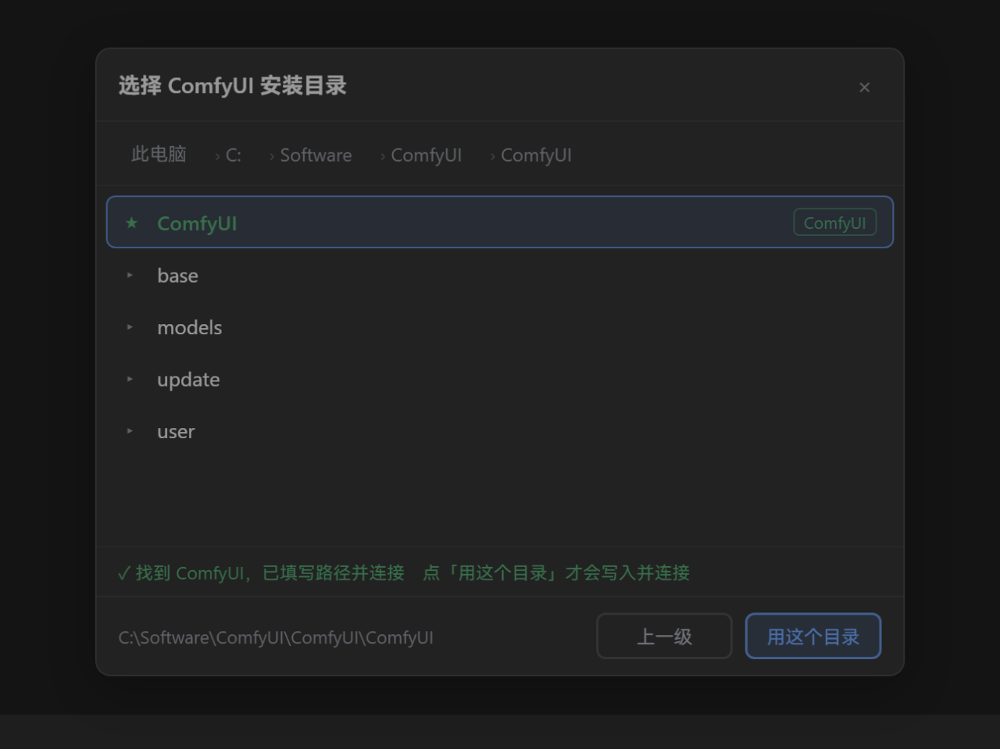
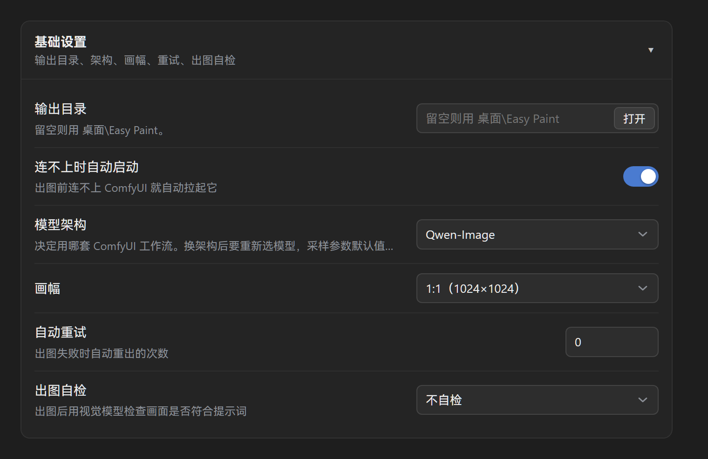
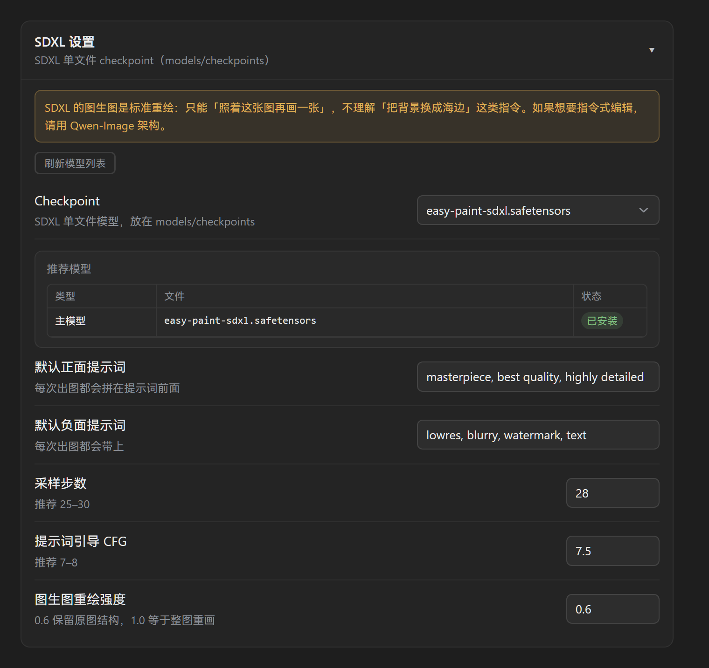
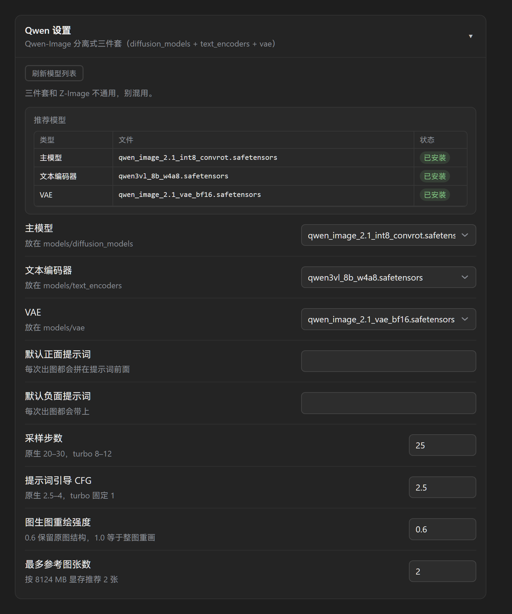
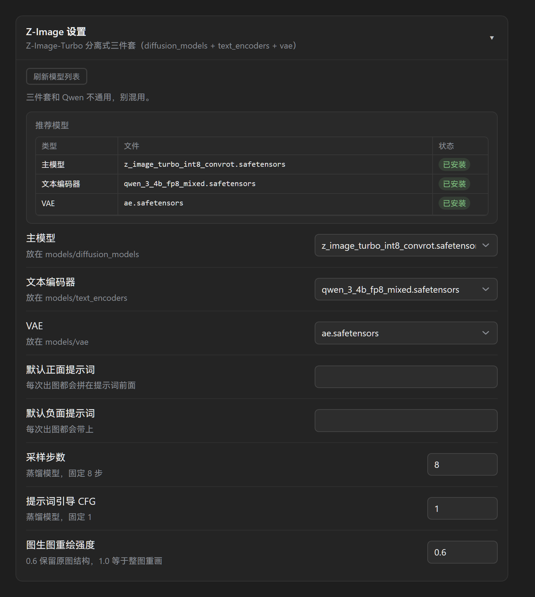
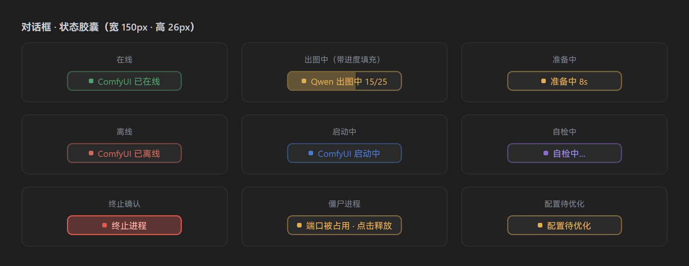

<p align="center">
  
</p>

# Easy Paint

> 在 [DeepSeek Harness](https://github.com/deepseek-ai) 里用本机 ComfyUI 生成图片的插件

给一段描述，出一张图；给几张参考图，按描述改。全部调用本机 ComfyUI，不联网、不产生 API 费用。
支持 **Qwen-Image**、**SDXL**、**Z-Image** 三套架构，可在设置页切换。SDXL 侧额外支持 LoRA（最多 5 个串联）。

[](./LICENSE)
[]()
[]()

> **关于名字**：这个插件最初叫 `Qwen Draw`，只支持 Qwen-Image 一个架构；后来陆续接入 SDXL 和 Z-Image，
> 名字也跟着改了几次（`qwen-draw-lite` → `dsh-paint-lite` → `dsh-easy-paint`）。
> 早期提交记录里还留着旧名字，完整演进见 [CHANGELOG](./CHANGELOG.md)。

---

## 快速开始

三步出一张图。前置条件只有一个：**本机装好 ComfyUI 并至少有一套模型**。

### 1. 装插件

```bash
dsh plugin add Hits-pano/dsh-easy-paint
```

或者从 [Releases](https://github.com/Hits-pano/dsh-easy-paint/releases/latest) 下载 `dsh-easy-paint.zip` 手动安装（步骤见[安装](#安装)）。

重启 DSH，设置里会出现 **Easy Paint**。

### 2. 连接 ComfyUI

打开设置页，顶部状态栏会显示当前连接情况：

| 状态栏显示 | 含义 |
|---|---|
| `请选择 ComfyUI 路径` | 还没配过，点右边的「选择 ComfyUI 路径」 |
| `已关联 ComfyUI，等待启动` | 路径配好了，ComfyUI 还没启动 |
| `v0.46.2 · http://127.0.0.1:8188` | ComfyUI 已启动，可以出图 |

点「选择 ComfyUI 路径」会弹出目录树，一路点到 ComfyUI 安装目录（含 `main.py` 和 `comfy` 的那层）。
插件会把该目录标绿并自动识别，点「用这个目录」即可。

**打开设置页时插件会自动扫一遍常见位置**，如果只找到一个 ComfyUI 就直接配好，不用手动选。

### 3. 说一句话

在对话里直接说：

```
画一只在窗台上的橘猫，午后阳光
```

也可以跳过对话，直接在设置页的**快速出图**面板里贴提示词点「出图」。

出图后自动保存到桌面 `Easy Paint` 文件夹，进度看对话框右下角的状态胶囊。

### 就这三步

剩下的都是可选项：LoRA、参考图、自动重试、视觉自检，按需在设置页打开。

---

## 界面

### 设置页总览

六个折叠面板自上而下：**快速出图** → **基础设置** → **SDXL 设置** → **Qwen 设置** → **Z-Image 设置** → **外观**。



### 快速出图

不经过对话，直接在这个面板里贴提示词出图。走的是和对话工具同一条链路，所以并发锁、自动拉起 ComfyUI、保存路径全都一致。

提示词在关掉设置页后仍然保留，直到你自己删掉或 DSH 重启。出图后左键点缩略图会打开所在文件夹并选中该文件，右上角 × 只关掉预览、不动文件。



### ComfyUI 路径选择

自绘的目录树，逐层浏览。含 `main.py` 和 `comfy` / `custom_nodes` 的目录会被标绿并排到最前。
点目录只选中，还要按「用这个目录」才写入配置并连接。



### 基础设置

输出目录、连不上时自动启动、模型架构、画幅、自动重试、出图自检。



### SDXL 设置

单文件 checkpoint + 5 个 LoRA 槽位。LoRA 状态会显示「已装载 / 跨系 / 不兼容 / 未选底模」。



### Qwen 设置

Qwen-Image 的主模型、文本编码器、VAE。带推荐模型表格，标出本机装了哪些。



### Z-Image 设置

Z-Image-Turbo 分离式三件套。注意文本编码器和 VAE 和 Qwen 不是同一套文件。



### 状态胶囊

对话框右下角那颗胶囊会跟着 ComfyUI 的状态变色。灯、文字、边框始终同色：



| 状态 | 含义 |
|---|---|
| **ComfyUI 已在线**（绿） | 空闲，可以出图 |
| **出图中 N/M**（黄，带进度填充） | 正在采样，整颗胶囊从左往右被填满 |
| **准备中 8s**（黄） | 任务已排队、采样进度还没到（模型加载/编码阶段），带秒数方便判断有没有卡住 |
| **ComfyUI 已离线**（红） | 点一下启动 |
| **ComfyUI 启动中**（蓝） | 正在拉起进程 |
| **自检中…**（紫） | 出图完成，正在调视觉模型检查 |
| **终止进程**（红底） | 二次确认态：3 秒内再点一次才真的终止 |
| **端口被占用 · 点击释放**（黄） | 端口被非 ComfyUI 进程占着，点一下清掉 |
| **配置待优化**（黄） | 参数偏离推荐范围，只提示不拦截 |

**在线 / 出图中**要终止 ComfyUI 得点两次：第一次只把文字换成「终止进程」并开始倒计时，
再点一次才执行——避免误触把正在跑的任务关掉。

---

## 特性

| 能力 | 说明 |
|---|---|
| **三架构** | Qwen-Image / SDXL / Z-Image，各有一套工作流，设置页切换 |
| **文生图** | 一句话出图，支持 7 种画幅 |
| **图生图** | Qwen 是指令式编辑，SDXL / Z-Image 是标准重绘 |
| **快速出图** | 设置页内置面板，不经过对话直接出图，提示词跨面板开关保留 |
| **LoRA（SDXL）** | 最多 5 个串联，各自独立权重 |
| **底模兼容检测** | 自动读 LoRA 元数据，判断和 Checkpoint 是否同系 |
| **配置预警** | 步数 / CFG 偏离推荐范围时输入框标黄，状态胶囊显示「配置待优化」；保存后立即更新 |
| **模型参数记忆** | 切换主模型自动带出该模型上次保存的步数和 CFG |
| **出图后清缓存** | 每张出完主动释放 ComfyUI 的 KV cache 和中间张量（不卸模型），连续出图不会越跑越卡 |
| **实时进度** | 状态胶囊显示「Qwen 出图中 4/10」「SDXL 出图中 12/28」「Z-Image 出图中 3/8」 |
| **路径自动检测** | 打开设置页自动扫常见位置；也可用内置目录树手动选择 |
| **自动启停 ComfyUI** | 出图前探活，没启动就自动拉起 |
| **出图自检** | 可选：开启后调用所选视觉模型检查画面；失败只提示、不丢图、不自动重画 |
| **自动重试** | 可选：一次出多张不同种子供挑选 |
| **模型列表离线可读** | 直接扫 `models/` 目录，不必先启动 ComfyUI |
| **配置感知提示** | 出图进程运行中修改设置时，保存区提示「改动将在出图进程结束后生效」 |

---

## 环境要求

- **ComfyUI**：已安装并可运行（默认 `http://127.0.0.1:8188`）
- **显卡**：建议 8 GB 显存以上
- **模型**：见下方[推荐模型](#推荐模型)

## 支持的架构

| 架构 | 模型格式 | 默认步数 / CFG | 图生图方式 |
|---|---|---|---|
| **Qwen-Image** | 分离式（UNET + CLIP + VAE） | 25 / 2.5（原生）· 10 / 1（turbo） | 指令式编辑，能理解「把背景换成海边」 |
| **SDXL** | 单文件 checkpoint | 28 / 7.5 | 标准重绘，只能「照着这张图再画一张」 |
| **Z-Image** | 分离式（diffusion + text encoder + VAE） | 8 / 1 | 标准重绘（同 SDXL） |

**SDXL 系**包括 SDXL 1.0、Illustrious、Pony、NoobAI 等所有基于 SDXL 架构微调的模型。

> ⚠️ **SD 1.5 不属于 SDXL 架构**。如果 LoRA 槽里选中 SD1.5 的 LoRA，会被自动跳过（不报错）。

> ⚠️ **Z-Image 的文本编码器和 VAE 和 Qwen 完全不通用**。别看名字都带 qwen，实际是两个不同模型。

---

## 安装

### 方式一：命令行（推荐）

```bash
dsh plugin add Hits-pano/dsh-easy-paint
```

或手动克隆：

```bash
cd /path/to/your/workspace
git clone https://github.com/Hits-pano/dsh-easy-paint.git
```

### 方式二：下载预构建包

从 [Releases](https://github.com/Hits-pano/dsh-easy-paint/releases/latest) 下载：

| 格式 | 适合 |
|---|---|
| `dsh-easy-paint.zip` | **Windows 手动安装**（双击解压） |
| `dsh-easy-paint.tgz` | 命令行 / 插件市场 |

**Windows 手动安装步骤**：

1. 下载 `dsh-easy-paint.zip`，解压
2. 把里面的 `package` 文件夹重命名为 `dsh-easy-paint`
3. 复制到 `%USERPROFILE%\.dsh\profiles\desktop\node_modules\`
4. 编辑 `%USERPROFILE%\.dsh\profiles\desktop\package.json`，在 `dsh.profile.bundles` 里加上 `dsh-easy-paint`
5. 重启 DSH

### 链接到 DSH profile（源码安装时）

```powershell
# Windows：用 Junction（不需要管理员权限）
mklink /J "$env:USERPROFILE\.dsh\profiles\desktop\node_modules\dsh-easy-paint" "D:\path\to\dsh-easy-paint"
```

### 在 profile 里启用

编辑 `~/.dsh/profiles/desktop/package.json`：

```json
{
  "dependencies": {
    "dsh-easy-paint": "link:D:/path/to/dsh-easy-paint"
  },
  "dsh": {
    "profile": {
      "bundles": [
        "...",
        "dsh-easy-paint"
      ]
    }
  }
}
```

### 重启 DSH

插件加载后，设置里会出现「Easy Paint」。

---

## 推荐模型

插件**不会自动下载模型**，需要什么会在面板里列出推荐清单并标出本机装了哪些。

### Qwen-Image

| 类型 | 文件 | 放哪里 |
|---|---|---|
| 主模型 | `qwen_image_2.1_int8_convrot.safetensors` | `models/diffusion_models/` |
| 文本编码器 | `qwen3vl_8b_w4a8.safetensors` | `models/text_encoders/` |
| VAE | `qwen_image_2.1_vae_bf16.safetensors` | `models/vae/` |

默认用上面这套**原生版**（25 步 / CFG 2.5）。想快可以换 turbo 版
`qwen_image_2.1_turbo_int8_convrot.safetensors`（10 步 / CFG 1），
画质略降；切换主模型时插件会自动带出对应参数。

### SDXL（按风格选）

| 风格 | 模型 |
|---|---|
| 写实 | Juggernaut XL |
| 动漫 | Illustrious XL / NoobAI |
| 官方基准 | SDXL Base 1.0 |

放 `models/checkpoints/`。

### Z-Image-Turbo

| 类型 | 文件 | 大小 | 放哪里 |
|---|---|---|---|
| diffusion | `z_image_turbo_int8_convrot.safetensors` | 5.78 GB | `models/diffusion_models/` |
| 文本编码器 | `qwen_3_4b_fp8_mixed.safetensors` | 5.25 GB | `models/text_encoders/` |
| VAE | `ae.safetensors` | 0.31 GB | `models/vae/` |

**下不到 int8 也可以用 `bf16`（11.46 GB，显存要求更高）。**

> ⚠️ **Z-Image 的 diffusion 模型必须放 `diffusion_models/`，不能放 `checkpoints/`**。
> 它是纯 diffusion 权重（没有 CLIP/VAE），`CheckpointLoaderSimple` 加载不了。

---

## 使用

### 文生图

```
画一只在窗台上的橘猫
```

### 图生图（Qwen，指令式）

```
把这张图的背景换成海边，其他保持原样
```

### 图生图（SDXL / Z-Image，标准重绘）

只能「照着这张图再画一张」，靠 `denoise` 控制改动幅度：

| denoise | 效果 |
|---|---|
| 0.3–0.5 | 几乎只改色调，结构完全保留 |
| **0.6**（默认） | 保留结构，画风/光线可变 |
| 0.8 | 大幅变化，只留大致构图 |
| 1.0 | 等于整图重画 |

### LoRA（SDXL）

SDXL 面板有 5 个 LoRA 槽位，每个可独立设置模型和权重（0–2，0.8 常用）。

| 颜色 | 含义 |
|---|---|
| 蓝「已装载」 | 和当前 Checkpoint 同系，效果最佳 |
| 黄「跨系 LoRA，效果可能不佳」 | 同架构但不同分支（如 SDXL 1.0 的 LoRA 用在 Illustrious 上） |
| 红「不兼容，LoRA 未生效」 | 不同架构（如 SD 1.5 的 LoRA），会被自动跳过 |
| 灰「未选底模，兼容性未知」 | 还没选 Checkpoint，无法比较 |

---

## 提示词建议

### Qwen-Image

**不需要质量标签**，用自然语言描述即可。默认正面词已设为 `high quality, detailed, sharp focus`。

### SDXL

默认正面词是 `masterpiece, best quality, high quality, detailed`。

**很多 LoRA 需要触发词**，这是最容易被忽略的一点：

| LoRA | 必需触发词 |
|---|---|
| chibistyle | **`chibi`**（不加会画成成年角色） |
| 多数角色 LoRA | 角色名 |
| 多数风格 LoRA | LoRA 作者页面标注的触发词 |

**单人要加 `solo`**，否则「chibi」类标签容易画出多个角色。

例：

```
chibi, solo, 1girl, brown ponytail, yellow hoodie, standing, full body
```

### Z-Image

**不需要质量标签**，默认正面词留空。用自然语言描述，模型会推理。

**强项**：中英文文字渲染。想要画面里出现准确的文字，直接写进提示词：

```
a wooden sign hanging on a tree, the sign reads "Z-Image" and 造相
```

**弱项**：图生图时文字容易消失（重绘会破坏笔画）。

### 底模与 LoRA 的匹配关系

```
SDXL 架构
├── SDXL 1.0（官方原版）
├── Illustrious（微调版）
├── Pony（微调版）
└── NoobAI（微调版）

SD 1.5 架构 —— 另一套体系，和上面全部不通用

Z-Image 架构 —— 独立体系，目前没有 LoRA 生态
```

- **架构决定能不能装**（同架构的都能加载）
- **训练底模决定好不好看**（同分支的效果最佳）

---

## 设置项

### 基础设置

| 项 | 说明 |
|---|---|
| 输出目录 | 留空则用 `桌面/Easy Paint`；右侧「打开」按钮直接打开该目录 |
| 连不上时自动启动 | 出图前探活，断了就自动拉起 ComfyUI |
| 模型架构 | Qwen-Image / SDXL / Z-Image，决定用哪套工作流 |
| 画幅 | 7 种比例 |
| 自动重试 | 0 = 一张，N = 连出 1+N 张不同种子 |
| 出图自检 | off（不自检）/ vision（调模型看图） |

### ComfyUI 状态栏

| 项 | 说明 |
|---|---|
| 状态文字 | 灰色单行，显示连接情况（见[快速开始](#2-连接-comfyui)） |
| 选择 ComfyUI 路径 | 打开目录树手动选择安装目录 |
| 状态胶囊 | 右侧那颗，显示实时状态并可点击启停 |

### Qwen 设置

主模型、文本编码器、VAE、推荐模型表格、采样参数、提示词、参考图上限。

默认底模是非 turbo 的原生 int8，配套 **25 步 / CFG 2.5**；换成
`qwen_image_2.1_turbo_int8_convrot` 时插件会自动切到 **10 步 / CFG 1**。

### SDXL 设置

Checkpoint、5 个 LoRA 槽、采样参数、提示词、重绘强度。

### Z-Image 设置

diffusion 模型、文本编码器、VAE（带推荐模型表格）、采样参数、提示词、重绘强度。

### 外观

对话框是否显示 ComfyUI 状态胶囊。

### 配置预警

参数或模型选得不对时，插件会提前提示，而不是等出图失败才发现。

| 架构 | CFG 推荐 | 步数推荐 |
|---|---|---|
| Qwen-Image（原生） | 2.5 – 4 | 20 – 30 |
| Qwen-Image（turbo） | 1 | 8 – 12 |
| SDXL | 7 – 8 | 25 – 30 |
| Z-Image-Turbo | 1 | 6 – 12 |

超出范围时：

1. 输入框变黄边，下方给出一句具体说明
2. 设置页底部汇总所有预警
3. 保存按钮变黄，第一次点击只把文字换成「确认保存」，再点一次才写盘
4. 状态胶囊显示黄字「配置待优化」

预警**只提示、不拦截**，照样能出图。保存后提示立即更新，不用等下一轮状态轮询。

---

## 常见问题

**Q：状态栏一直显示「请选择 ComfyUI 路径」？**

点「选择 ComfyUI 路径」，在目录树里找到含 `main.py` 和 `comfy` 文件夹的那一层（通常是最里面的 `ComfyUI`），选中后点「用这个目录」。

**Q：路径选好了但状态栏还是「已关联，等待启动」？**

说明路径对了，ComfyUI 没启动。点一下状态胶囊启动，或确认「连不上时自动启动」开关是开的。

**Q：模型下拉是空的？**

先点「刷新模型列表」。插件会直接扫 `models/` 目录，不需要 ComfyUI 运行。

**Q：LoRA 显示「文件已失效」然后变空？**

文件被改名或删除了。配置里记的名字在 `models/loras` 下找不到，插件会自动清空该槽位。

**Q：LoRA 显示黄灯「跨系」能用吗？**

能。只是效果会打折，因为训练底模和当前 Checkpoint 不是同一分支。

**Q：LoRA 显示红灯「不兼容」？**

不同架构（比如 SD1.5 的 LoRA 配 SDXL 底模）。插件会静默跳过它，出图不受影响，但那个 LoRA 不起作用。

**Q：Z-Image 的模型放进去不显示？**

检查是不是放错了目录。Z-Image 的 diffusion 模型必须放 `models/diffusion_models/`，**不能放 `models/checkpoints/`**。

**Q：Z-Image 能跑多快？**

8 步、CFG 1、int8 量化，8 GB 显存实测约 18 秒一张（不含 ComfyUI 启动）。

**Q：出图中改设置会怎样？**

配置照常保存，但当前这一轮用的是启动时读到的参数，所以保存区会提示「有出图进程正在运行，改动将在出图进程结束后生效」。

**Q：画出来的人物数量和描述不符？**

加 `solo` 或 `1girl` 标签。很多动漫系标签默认往「多角色」方向走。

**Q：图生图改不动背景/颜色？**

重绘强度太低。SDXL / Z-Image 调到 0.8–0.9 试试；Qwen 是指令式编辑，直接改提示词即可。

---

## 已知限制

- **工作流内置**，不支持导入自定义 ComfyUI 工作流
- **不支持 ControlNet**（需要的话请改源码）
- **SDXL / Z-Image 的图生图是标准重绘**，不支持 Qwen 那种指令式编辑
- **图生图只取第一张参考图**
- **只支持图像生成**，不支持视频
- **Z-Image 官方 Edit 模型还没发布**，图生图靠标准重绘实现
- **8 GB 显存下两张参考图很勉强**：Qwen 主模型 6.9 GB + 文本编码器 6 GB +
  VAE 0.6 GB + 两张参考图的 KV cache 约 4.2 GB，合计约 17.8 GB 已远超物理显存，
  靠 ComfyUI 动态卸载硬撑。插件会在每次出图后清一次缓存（不卸载模型）来缓解
  累积，但想稳还是建议参考图上限设成 1 张（实测 1 张成功 184 次、2 张只撑了 23 次）

---

## 仓库结构

| 文件 / 目录 | 用途 |
|---|---|
| `index.js` | Host 侧：注册 `draw_image` 工具、构建三套架构的 ComfyUI 工作流、解析配置、自动启停 ComfyUI、目录浏览与路径校验 |
| `client.js` | 设置页：6 个折叠面板、状态胶囊、快速出图、目录树、参数预警计算，以及这个插件的全部 CSS |
| `package.json` | 插件清单，`dsh.bundle.patch` 指向 `cordis.patch.yml` |
| `cordis.patch.yml` | 插件挂载点（bundle 声明） |
| `locale/zh.json`、`locale/en.json` | 插件列表卡片的标题与描述（显示在 DSH 的插件页面里） |
| `icon.svg`、`assets/icon-180.png` | 插件图标，矢量与位图各一份 |
| `docs/*.png` | README 里引用的界面示意图，制作方式见 [`docs/README.md`](./docs/README.md) |
| `screenshots.json` | 截图清单，插件市场读取 |
| `CHANGELOG.md` | 按版本记录的变更历史 |

> GitHub 文件列表里每个条目后面那行灰字，是该文件**最后一次提交**的说明（commit message），
> 不是文件当前功能的描述。要看每个文件现在负责什么，以上表为准。

## 致谢

工作流设计与参数取值参考了 **dsh-qwen-paint**（作者 [@yanfei0725](https://github.com/yanfei0725)）。
本项目为独立实现，未包含其源代码。

## 许可

[MIT](./LICENSE)
