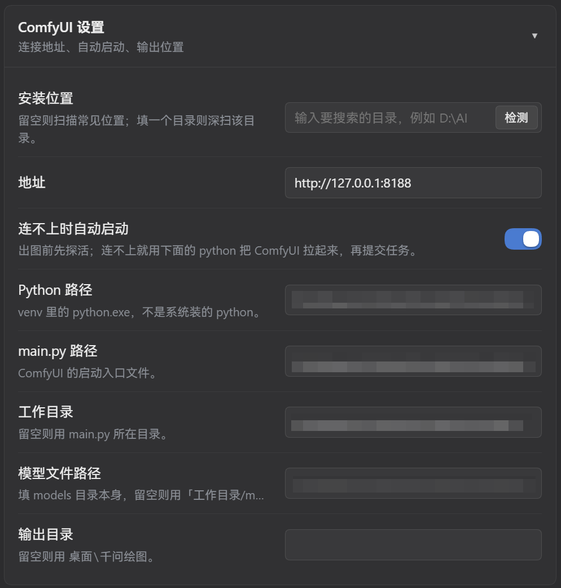
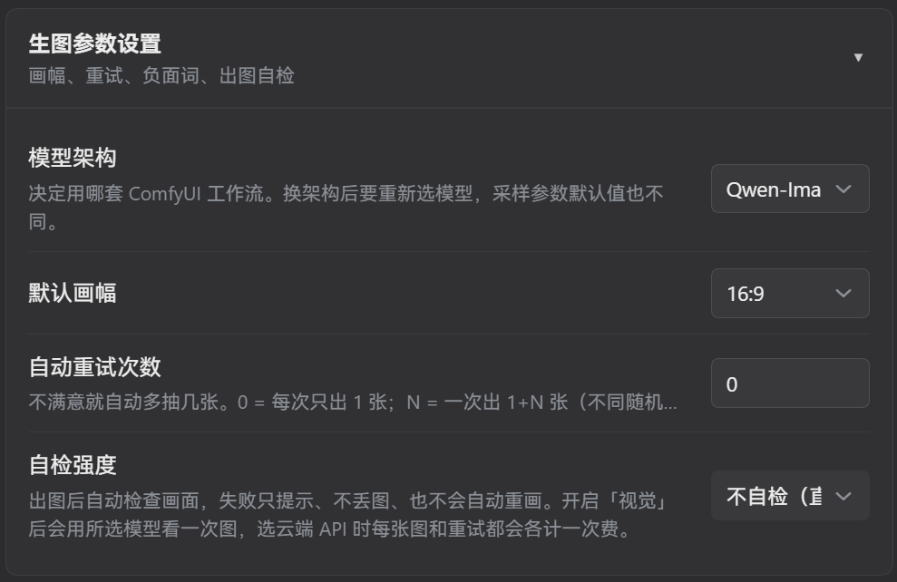
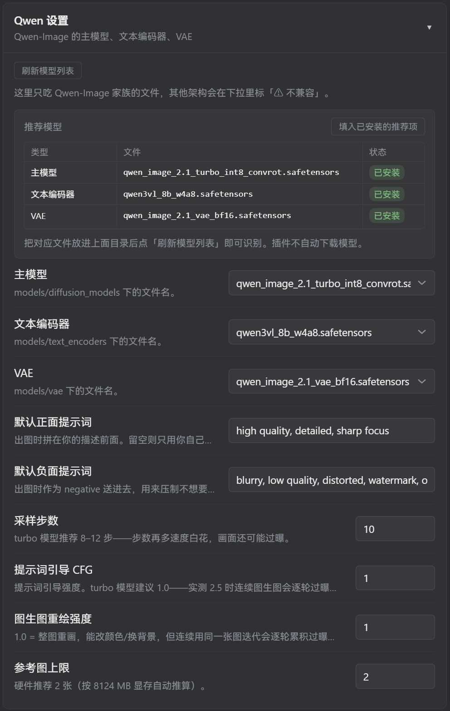
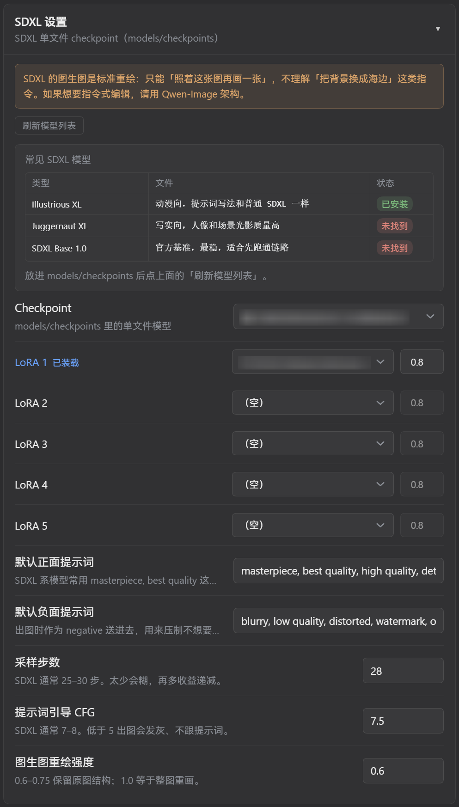
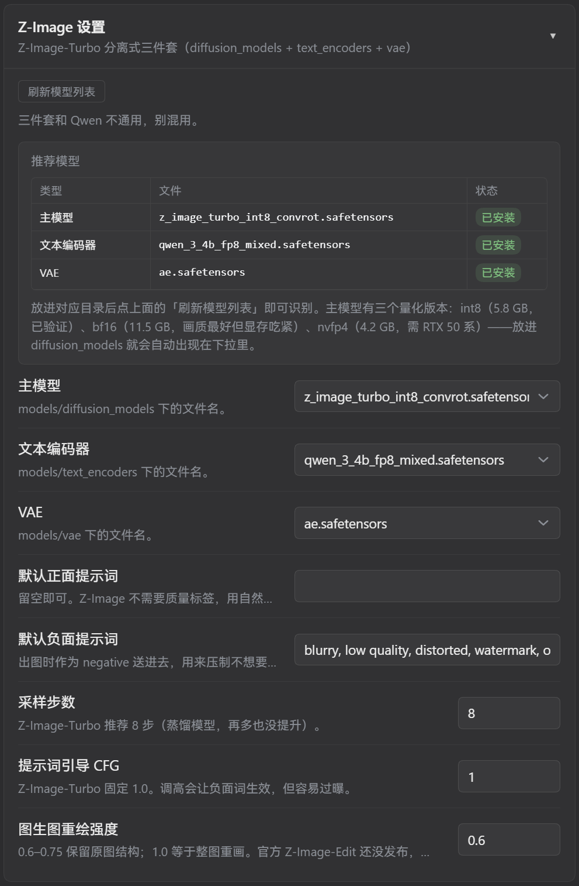
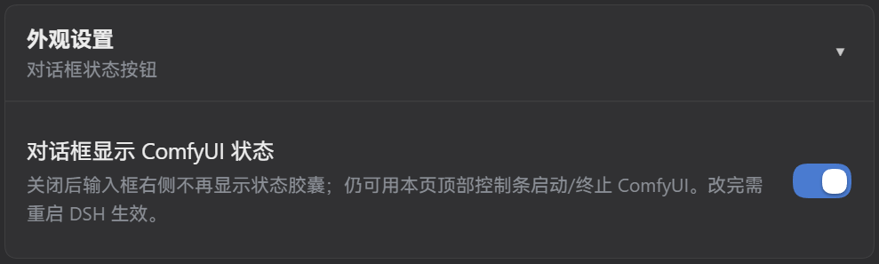

# Easy Paint

> 在 [DeepSeek Harness](https://github.com/deepseek-ai) 里用本机 ComfyUI 生成图片的插件

给一段描述，出一张图。给几张参考图，按描述改。**生图这一段的调用全部发向你本机的 ComfyUI**，不经过任何外部服务。

支持 **Qwen-Image**、**SDXL**、**Z-Image** 三套架构，可在设置页切换。SDXL 侧额外支持 LoRA（最多 5 个串联）。

插件里会调用模型的地方只有一处：**视觉自检**。它默认关闭，需要你主动打开并选定模型，之后每张图多一次调用（选云端 API 模型则计费，本地模型不经过 API）。默认档位「轻量自检」只读文件头和尺寸，不调用模型。

[](./LICENSE)
[]()
[]()

> **关于名字**：这个插件最初叫 `Qwen Draw`，只支持 Qwen-Image 一个架构；后来陆续接入 SDXL 和 Z-Image，
> 名字也跟着改了几次（`qwen-draw-lite` → `dsh-paint-lite` → `dsh-easy-paint`）。
> 早期提交记录里还留着旧名字，完整演进见 [CHANGELOG](./CHANGELOG.md)。

---

## 快速开始

三步出一张图。前置条件只有一个：**本机装好 ComfyUI 并至少有一套模型**。

### 1. 装插件

```bash
dsh plugin add Hits-pano/dsh-easy-paint
```

或者从 [Releases](https://github.com/Hits-pano/dsh-easy-paint/releases/latest) 下载 `dsh-easy-paint.zip`，解压后放进 profile 的 `node_modules`（步骤见下方[安装](#安装)）。

重启 DSH，设置里会出现 **Easy Paint**。

### 2. 选架构、选模型

设置页 → **生图参数设置** → 选一套架构：

| 你的情况 | 选哪个 |
|---|---|
| 想画海报、招牌、带文字的图 | **Z-Image**（8 步最快，文字渲染最强） |
| 想用 LoRA、画动漫 | **SDXL** |
| 想指令式改图、做连续镜头 | **Qwen-Image** |

然后到对应面板里选模型，点「刷新模型列表」能看到本机已装的。**插件不会自动下载模型**，需要什么会在面板里列出推荐清单。

### 3. 说一句话

在对话里直接说：

```
画一只在窗台上的橘猫，午后阳光
```

状态胶囊会显示进度（「Z-Image 出图中 3/8」「Qwen 出图中 4/10」这样），出图后自动保存到桌面 `Easy Paint` 文件夹。

### 就这三步

剩下的都是可选项：LoRA、参考图、自动重试、出图自检，按需在设置页打开。

**第一次用不成功的话**，先看[常见问题](#常见问题)——尤其是「模型下拉是空的」和「出图报错找不到模型」这两条。

---

## 特性

| 能力 | 说明 |
|---|---|
| **三架构** | Qwen-Image / SDXL / Z-Image，各有一套工作流，设置页切换 |
| **文生图** | 一句话出图，支持 7 种画幅 |
| **图生图** | Qwen 是指令式编辑，SDXL / Z-Image 是标准重绘 |
| **LoRA（SDXL）** | 最多 5 个串联，各自独立权重 |
| **底模兼容检测** | 自动读 LoRA 元数据，判断和 Checkpoint 是否同系 |
| **实时进度** | 状态胶囊显示「Qwen 出图中 4/10」「SDXL 出图中 12/28」「Z-Image 出图中 3/8」 |
| **自动启停 ComfyUI** | 出图前探活，没启动就自动拉起 |
| **出图自检** | 可选：「轻量」只查文件尺寸，不调用任何模型 /「视觉」才调模型看图 |
| **自动重试** | 可选：一次出多张不同种子供挑选 |
| **原生设置页** | 6 个折叠面板，改完点保存生效 |
| **路径自动检测** | 首次安装扫一遍磁盘，自动填好 Python 和 main.py 路径 |
| **模型列表离线可读** | 直接扫 `models/` 目录，不必先启动 ComfyUI |

## 截图

### 设置页全貌

六个折叠面板：ComfyUI 设置 / 生图参数设置 / Qwen 设置 / SDXL 设置 / Z-Image 设置 / 外观设置。


### ComfyUI 设置

连接地址、自动启动、输出位置。新增「模型文件路径」，留空则用「工作目录/models」。



### 生图参数设置

决定用哪套 ComfyUI 工作流。换架构后要重新选模型，采样参数默认值也不同。



### Qwen 设置

Qwen-Image 的主模型、文本编码器、VAE。带推荐模型表格，标出本机装了哪些。



### SDXL 设置

单文件 checkpoint + 5 个 LoRA 槽位。LoRA 状态会显示「已装载 / 跨系 / 不兼容 / 未选底模」。



### Z-Image 设置

Z-Image-Turbo 分离式三件套。带推荐模型表格，标出本机装了哪些；注意文本编码器和 VAE 和 Qwen 不是同一套文件。



### 外观设置

对话框状态按钮开关。



## 环境要求

- **ComfyUI**：已安装并可运行（默认 `http://127.0.0.1:8188`）
- **显卡**：建议 8 GB 显存以上
- **模型**：见下方[推荐模型](#推荐模型)

## 支持的架构

| 架构 | 模型格式 | 步数 | 图生图方式 |
|---|---|---|---|
| **Qwen-Image** | 分离式（UNET + CLIP + VAE） | 10 | 指令式编辑，能理解「把背景换成海边」 |
| **SDXL** | 单文件 checkpoint | 28 | 标准重绘，只能「照着这张图再画一张」 |
| **Z-Image** | 分离式（diffusion + text encoder + VAE） | 8 | 标准重绘（同 SDXL） |

**SDXL 系**包括 SDXL 1.0、Illustrious、Pony、NoobAI 等所有基于 SDXL 架构微调的模型。

> ⚠️ **SD 1.5 不属于 SDXL 架构**。如果 LoRA 槽里选中 SD1.5 的 LoRA，会被自动跳过（不报错）。

> ⚠️ **Z-Image 的文本编码器和 VAE 和 Qwen 完全不通用**。别看名字都带 qwen，实际是两个不同模型。

## 安装

### 方式一：命令行（推荐）

```bash
dsh plugin add Hits-pano/dsh-easy-paint
```

或手动克隆：

```bash
cd /path/to/your/workspace
git clone https://github.com/Hits-pano/dsh-easy-paint.git
```

### 方式二：下载预构建包

从 [Releases](https://github.com/Hits-pano/dsh-easy-paint/releases/latest) 下载：

| 格式 | 大小 | 适合 |
|---|---|---|
| `dsh-easy-paint.zip` | 1.6 MB | **Windows 手动安装**（双击解压） |
| `dsh-easy-paint.tgz` | 1.1 MB | 命令行 / 插件市场 |

**Windows 手动安装步骤**：

1. 下载 `dsh-easy-paint.zip`，解压
2. 把里面的 `package` 文件夹重命名为 `dsh-easy-paint`
3. 复制到 `%USERPROFILE%\.dsh\profiles\desktop\node_modules\`
4. 编辑 `%USERPROFILE%\.dsh\profiles\desktop\package.json`，在 `dsh.profile.bundles` 里加上 `dsh-easy-paint`
5. 重启 DSH

### 链接到 DSH profile（源码安装时）

```powershell
# Windows：用 Junction（不需要管理员权限）
mklink /J "$env:USERPROFILE\.dsh\profiles\desktop\node_modules\dsh-easy-paint" "D:\path\to\dsh-easy-paint"
```

### 在 profile 里启用

编辑 `~/.dsh/profiles/desktop/package.json`：

```json
{
  "dependencies": {
    "dsh-easy-paint": "link:D:/path/to/dsh-easy-paint"
  },
  "dsh": {
    "profile": {
      "bundles": [
        "...",
        "dsh-easy-paint"
      ]
    }
  }
}
```

### 重启 DSH

插件加载后，设置里会出现「Easy Paint」。

## 首次配置

### 检测路径

设置页 → ComfyUI 设置 → 点「检测安装位置」，插件会扫常见路径并自动填好：

- Python 路径
- main.py 路径
- 工作目录
- **模型文件路径**（自动推导为 `<工作目录>/models`，也可手填）

### 推荐模型

**Qwen-Image**

| 类型 | 文件 | 放哪里 |
|---|---|---|
| 主模型 | `qwen_image_2.1_int8_convrot.safetensors` | `models/diffusion_models/` |
| 文本编码器 | `qwen3vl_8b_w4a8.safetensors` | `models/text_encoders/` |
| VAE | `qwen_image_2.1_vae_bf16.safetensors` | `models/vae/` |

**SDXL（按风格选）**

| 风格 | 模型 |
|---|---|
| 写实 | Juggernaut XL |
| 动漫 | Illustrious XL / NoobAI |
| 官方基准 | SDXL Base 1.0 |

放 `models/checkpoints/`。

**Z-Image-Turbo**

| 类型 | 文件 | 大小 | 放哪里 |
|---|---|---|---|
| diffusion | `z_image_turbo_int8_convrot.safetensors` | 5.78 GB | `models/diffusion_models/` |
| 文本编码器 | `qwen_3_4b_fp8_mixed.safetensors` | 5.25 GB | `models/text_encoders/` |
| VAE | `ae.safetensors` | 0.31 GB | `models/vae/` |

**下不到 int8 也可以用 `bf16`（11.46 GB，显存要求更高）。**

> ⚠️ **Z-Image 的 diffusion 模型必须放 `diffusion_models/`，不能放 `checkpoints/`**。
> 它是纯 diffusion 权重（没有 CLIP/VAE），`CheckpointLoaderSimple` 加载不了。

## 使用

### 文生图

```
画一只在窗台上的橘猫
```

### 图生图（Qwen，指令式）

```
把这张图的背景换成海边，其他保持原样
```

### 图生图（SDXL / Z-Image，标准重绘）

只能「照着这张图再画一张」，靠 `denoise` 控制改动幅度：

| denoise | 效果 |
|---|---|
| 0.3–0.5 | 几乎只改色调，结构完全保留 |
| **0.6**（默认） | 保留结构，画风/光线可变 |
| 0.8 | 大幅变化，只留大致构图 |
| 1.0 | 等于整图重画 |

### LoRA（SDXL）

SDXL 面板有 5 个 LoRA 槽位，每个可独立设置模型和权重（0–2，0.8 常用）。

**槽位状态提示**：

| 颜色 | 含义 |
|---|---|
| 蓝「已装载」 | 和当前 Checkpoint 同系，效果最佳 |
| 黄「跨系 LoRA，效果可能不佳」 | 同架构但不同分支（如 SDXL 1.0 的 LoRA 用在 Illustrious 上） |
| 红「不兼容，LoRA 未生效」 | 不同架构（如 SD 1.5 的 LoRA），会被自动跳过 |
| 灰「未选底模，兼容性未知」 | 还没选 Checkpoint，无法比较 |

## 提示词建议

### Qwen-Image

**不需要质量标签**，用自然语言描述即可。默认正面词已设为 `high quality, detailed, sharp focus`。

### SDXL

默认正面词是 `masterpiece, best quality, high quality, detailed`。

**很多 LoRA 需要触发词**，这是最容易被忽略的一点：

| LoRA | 必需触发词 |
|---|---|
| chibistyle | **`chibi`**（不加会画成成年角色） |
| 多数角色 LoRA | 角色名 |
| 多数风格 LoRA | LoRA 作者页面标注的触发词 |

**单人要加 `solo`**，否则「chibi」类标签容易画出多个角色。

例：

```
chibi, solo, 1girl, brown ponytail, yellow hoodie, standing, full body
```

### Z-Image

**不需要质量标签**，默认正面词留空。用自然语言描述，模型会推理。

**强项**：中英文文字渲染。想要画面里出现准确的文字，直接写进提示词：

```
a wooden sign hanging on a tree, the sign reads "Z-Image" and 造相
```

**弱项**：图生图时文字容易消失（重绘会破坏笔画）。

### 参考：底模与 LoRA 的匹配关系

```
SDXL 架构
├── SDXL 1.0（官方原版）
├── Illustrious（微调版）
├── Pony（微调版）
└── NoobAI（微调版）

SD 1.5 架构 —— 另一套体系，和上面全部不通用

Z-Image 架构 —— 独立体系，目前没有 LoRA 生态
```

- **架构决定能不能装**（同架构的都能加载）
- **训练底模决定好不好看**（同分支的效果最佳）

## 设置项

### ComfyUI 设置

| 项 | 说明 |
|---|---|
| 安装位置 | 留空扫常见路径；填目录则深扫 |
| 地址 | ComfyUI 的 HTTP 地址，默认 `http://127.0.0.1:8188` |
| 连不上时自动启动 | 出图前探活，断了就用下面的 python 拉起来 |
| Python 路径 | venv 里的 python.exe |
| main.py 路径 | ComfyUI 启动入口 |
| 工作目录 | 留空则用 main.py 所在目录 |
| 模型文件路径 | 填 models 目录本身，留空则用「工作目录/models」 |
| 输出目录 | 留空则用 `桌面/Easy Paint` |

### 生图参数设置

| 项 | 说明 |
|---|---|
| **模型架构** | Qwen-Image / SDXL / Z-Image，决定用哪套工作流 |
| 默认画幅 | 7 种比例 |
| 自动重试 | 0 = 一张，N = 连出 1+N 张不同种子 |
| 自检强度 | off（不自检）/ light（只读文件，**不调用任何模型**）/ vision（调模型看图） |

### Qwen 设置

主模型、文本编码器、VAE、推荐模型表格、采样参数、提示词、参考图上限。

### SDXL 设置

Checkpoint、5 个 LoRA 槽、采样参数、提示词、重绘强度。

### Z-Image 设置

diffusion 模型、文本编码器、VAE（带推荐模型表格）、采样参数、提示词、重绘强度。

### 外观设置

对话框是否显示 ComfyUI 状态胶囊。

## 常见问题

**Q：模型下拉是空的？**

先点「刷新模型列表」。插件会直接扫 `models/` 目录，不需要 ComfyUI 运行。

**Q：LoRA 显示「文件已失效」然后变空？**

文件被改名或删除了。配置里记的名字在 `models/loras` 下找不到，插件会自动清空该槽位。

**Q：LoRA 显示黄灯「跨系」能用吗？**

能。只是效果会打折，因为训练底模和当前 Checkpoint 不是同一分支。

**Q：LoRA 显示红灯「不兼容」？**

不同架构（比如 SD1.5 的 LoRA 配 SDXL 底模）。插件会静默跳过它，出图不受影响，但那个 LoRA 不起作用。

**Q：Z-Image 的模型放进去不显示？**

检查是不是放错了目录。Z-Image 的 diffusion 模型必须放 `models/diffusion_models/`，**不能放 `models/checkpoints/`**。

**Q：Z-Image 能跑多快？**

8 步、CFG 1、int8 量化，8 GB 显存实测约 18 秒一张（不含 ComfyUI 启动）。

**Q：Z-Image 图生图为什么文字会消失？**

标准重绘会重建像素，中文笔画复杂容易被破坏。这是图生图的固有问题，需要保文字就用文生图。

**Q：画出来的人物数量和描述不符？**

加 `solo` 或 `1girl` 标签。很多动漫系标签默认往「多角色」方向走。

**Q：图生图改不动背景/颜色？**

重绘强度太低。SDXL / Z-Image 调到 0.8–0.9 试试；Qwen 是指令式编辑，直接改提示词即可。

## 已知限制

- **工作流内置**，不支持导入自定义 ComfyUI 工作流
- **不支持 ControlNet**（需要的话请改源码）
- **SDXL / Z-Image 的图生图是标准重绘**，不支持 Qwen 那种指令式编辑
- **图生图只取第一张参考图**
- **只支持图像生成**，不支持视频
- **Z-Image 官方 Edit 模型还没发布**，图生图靠标准重绘实现

## 致谢

工作流设计与参数取值参考了 **dsh-qwen-paint**（作者 [@yanfei0725](https://github.com/yanfei0725)）。
本项目为独立实现，未包含其源代码。

## 许可

[MIT](./LICENSE)
